<picture>
  <source media="(prefers-color-scheme: dark)" srcset="./assets/banner.svg">
  <source media="(prefers-color-scheme: light)" srcset="./assets/banner-light.svg">
  
</picture>

 

**Transformamos lugares, dados e necessidades em soluções digitais.**

[Sobre](#sobre) · [O que fazemos](#o-que-fazemos) · [Projetos](#projetos) · [Como trabalhamos](#como-trabalhamos) · [Tecnologia](#tecnologia) · [Equipe](#equipe) · [Contato](#contato)

---

## Sobre

A **Geotech** é uma empresa de geotecnologia de Caruaru, Pernambuco. Desenvolvemos software que **organiza, conecta e representa informações de espaços reais**: mapas, dados e aplicativos que transformam realidades complexas em informação utilizável.

> Antes de digitalizar um espaço, precisamos entender como ele funciona.

## O que fazemos

| | Pilar | Entregamos |
|---|---|---|
| 📍 | **Geolocalização** | Mapas, posicionamento, rotas e representação espacial |
| 🗂️ | **Dados** | Estruturação, organização, filtros e integração de informações |
| 💻 | **Software** | Aplicativos e sistemas que transformam dados em experiências |

Atuamos em **cidades inteligentes, mobilidade, turismo, comércio, eventos, logística, gestão pública** e **aplicativos personalizados**. Cada espaço tem necessidades diferentes, e a tecnologia precisa se adaptar a ele.

## Projetos

### Aqui na Feira
> Tecnologia para compreender e conectar uma das maiores feiras do Brasil.

Nosso primeiro grande case, desenvolvido em parceria com a **Prefeitura de Caruaru**. O projeto digitaliza e organiza as informações da Feira de Caruaru por meio de geolocalização, e o aplicativo responde a quatro perguntas: **o que tem, quem tem, onde fica e como chego**.

| Mapa | Dados | Experiência |
|---|---|---|
| Representação espacial da feira | Organização das informações por setor | Acesso via aplicativo |

**Status:** em desenvolvimento

<b>O desafio por trás do projeto</b>

 

O desafio não era apenas criar um mapa, e sim **estruturar uma realidade** com informações fragmentadas e diferentes formas de organização:

- Diferentes estruturas de informação e dados distribuídos entre setores
- Necessidade de padronização e de unificar as formas de organização dos dados
- Dificuldade de quantificação
- Necessidade de compreender os processos existentes

Realidade → informações fragmentadas → padronização → dados estruturados → geolocalização → solução digital.

## Como trabalhamos

1. **Compreender:** conhecer o espaço e seus processos.
2. **Organizar:** identificar e estruturar as informações.
3. **Localizar:** relacionar os dados ao espaço físico.
4. **Conectar:** transformar tudo em uma solução digital.

## Tecnologia

| Camada | Tecnologia |
|---|---|
| Aplicação | React Native |
| API | NestJS |
| Dados espaciais | PostgreSQL / GIS |
| Mapa e geo | MapLibre · GeoJSON |

**Competências:** geolocalização · mapas interativos · dados espaciais · desenvolvimento mobile · arquitetura de software · estruturação de dados · APIs

## Equipe

Um time fullstack construindo soluções de ponta a ponta.

| Nome | Atuação |
|---|---|
| **Poliana Sidere** | Frontend e arquitetura: React Native, arquitetura de aplicações e experiência mobile |
| **Pedro Henrique** | Backend e banco de dados: APIs, estruturação de dados e integração de serviços |
| **Valmir Alfredo** | Backend: infraestrutura, banco de dados e lógica de negócio |
| **Wyldson Marllon** | Backend: APIs, geoprocessamento e integração de dados espaciais |

## Contato

Tem um espaço, um processo ou uma ideia que precisa virar solução digital? Fale com a gente.

- **Instagram:** [@@geotech.solucoes](https://instagram.com/)
- **E-mail:** [contato.geotechsolucoes@gmail.com](mailto:contato.geotechsolucoes@gmail.com)
- **Site:** [seudominio.com](https://seudominio.com)

---

<b>GEOTECH</b> · Caruaru, Pernambuco · 08.2828° S, 35.9737° W

